<!--
Copyright (c) 2026 Apryse Group NV
SPDX-License-Identifier: MIT
See LICENSE in the repository root.
-->

# itext-markdown2pdf

GitHub Action that converts Markdown using iText and produces one output file:

- **File input** → a single `.pdf`.
- **Folder input** → a `.zip` containing a PDF for each `.md` file, recursively,
  with the input folder structure preserved (even if there is only one `.md`).

- Linux x86_64 runners only (`runs-on: ubuntu-latest`). Self-hosted runners
  also need Bash, GNU coreutils/findutils, and `zip` on `PATH`.
- Public (open source) repositories only — the converter verifies repository
  visibility through the GitHub API and refuses to run otherwise.
- The converter is committed to this repo (`bin/itext-markdown2pdf`), so nothing
  is downloaded at runtime.

## Table of contents

- [Usage](#usage)
- [Inputs](#inputs)
- [Outputs](#outputs)
- [Examples](#examples)
  - [Nested lists](#nested-lists)
  - [Images and captions](#images-and-captions)
  - [Screenshots and section headings](#screenshots-and-section-headings)
  - [Alerts](#alerts)
  - [Inline code and heading levels](#inline-code-and-heading-levels)
  - [Banner images and badges](#banner-images-and-badges)
  - [Code blocks with syntax highlighting](#code-blocks-with-syntax-highlighting)
  - [Text formatting](#text-formatting)
- [Permissions](#permissions)
- [Troubleshooting](#troubleshooting)
- [Layout](#layout)
- [Contributing](#contributing)
- [License](#license)

## Usage

```yaml
permissions:
  contents: read

jobs:
  convert:
    runs-on: ubuntu-latest
    steps:
      - uses: actions/checkout@v4

      - uses: itext/markdown2pdf@v1
        id: convert
        with:
          input: 'docs'
          output: 'dist/documents.zip'

      - uses: actions/upload-artifact@v4
        with:
          name: itext-markdown2pdf-output
          path: ${{ steps.convert.outputs.output-path }}
          if-no-files-found: error
```

For a single PDF, set `input: 'README.md'` and `output: 'dist/README.pdf'`.
The upload step works unchanged for either mode. The action creates the file
in the runner's workspace; `actions/upload-artifact` makes it available from
the workflow run's **Artifacts** section. Without an upload step, the file is
not retained when the runner is discarded. GitHub wraps uploaded artifacts in
its own download archive.

## Inputs

| Name              | Description                                                                      | Required |
|-------------------|----------------------------------------------------------------------------------|----------|
| `input`           | Path to a markdown file or folder to convert                                     | yes      |
| `output`          | Destination `.pdf` for file input, or `.zip` for folder input                    | yes      |
| `repository-name` | Name of the repository the markdown belongs to (defaults to `github.repository`) | no       |
| `branch-name`     | Name of the branch the markdown belongs to (defaults to `github.ref_name`)       | no       |

Paths are relative to the workspace unless absolute. `output` must be a file,
not a directory (replace older folder destinations such as `dist/pdf` with
`dist/documents.zip`). A folder without `.md` files fails instead of producing
an empty archive. Only PDFs from the current conversion are included; existing
PDFs in the input folder are not copied. Successful runs replace the destination;
conversion failures leave an existing destination unchanged.

## Outputs

| Name          | Description                                    |
|---------------|------------------------------------------------|
| `output-path` | Absolute path to the generated PDF or ZIP file |
| `output-type` | `pdf` or `zip`                                 |
| `pdf-count`   | Number of generated PDFs                       |

Generated PDFs use PDF 2.0 and conform to PDF/UA-2. As Markdown already expresses document semantics such as headings,
lists, tables, links, and alternative text, it is a natural source for the lightweight generation of tagged,
machine-readable PDFs that meet the latest ISO standard for accessible PDF.

## Examples

See how Markdown documents look before and after conversion. Each example is
the README of a popular public repository: on the left as GitHub renders it, on
the right as the PDF/UA-2 file produced by this action. Select a PDF link to
download the full document and inspect its tags.

Badge values are live, so they may differ slightly between the two screenshots.

### Nested lists

[itext/itext-dotnet](https://github.com/itext/itext-dotnet#readme):
a centered logo, badges, bold text, and two-level bulleted lists.
([PDF](docs/examples/itext-dotnet.pdf))

| Markdown input | PDF output |
| --- | --- |
| 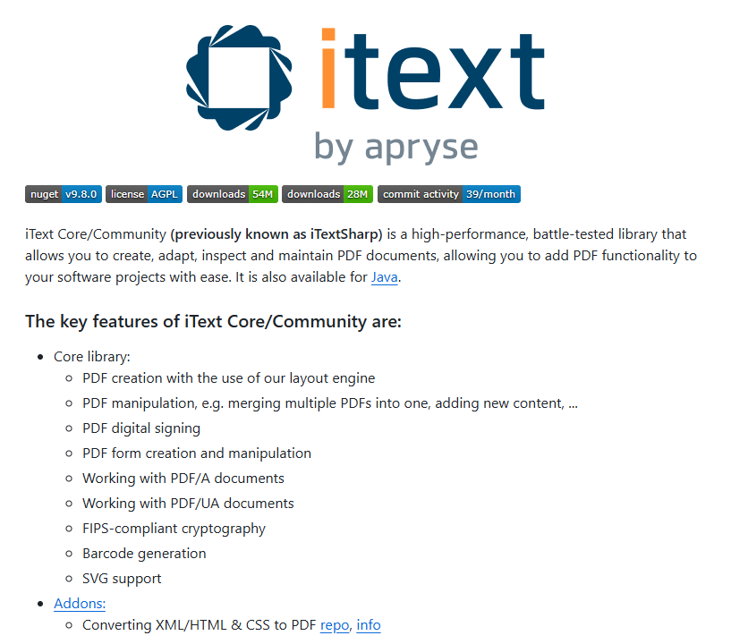 | 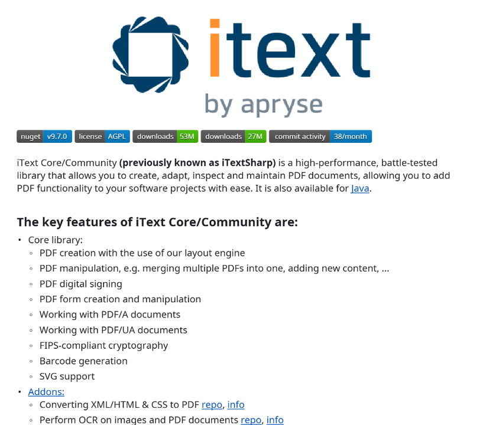 |

### Images and captions

[golang/go](https://github.com/golang/go#readme):
a heading, a full-width illustration, and an italic caption with links.
([PDF](docs/examples/golang.pdf))

| Markdown input | PDF output |
| --- | --- |
|  | 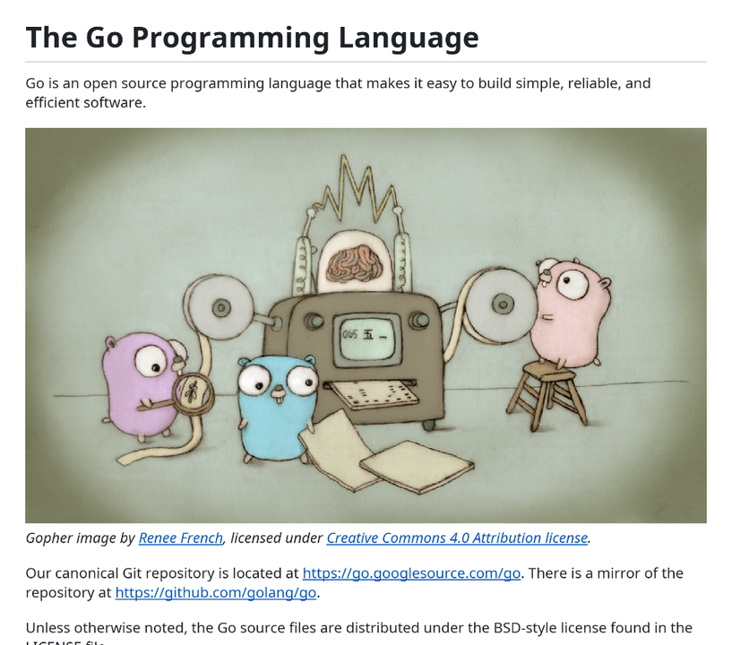 |

### Screenshots and section headings

[microsoft/vscode](https://github.com/microsoft/vscode#readme):
badges, inline code, links, section headings, and a large product screenshot.
([PDF](docs/examples/vscode.pdf))

| Markdown input | PDF output |
| --- | --- |
| 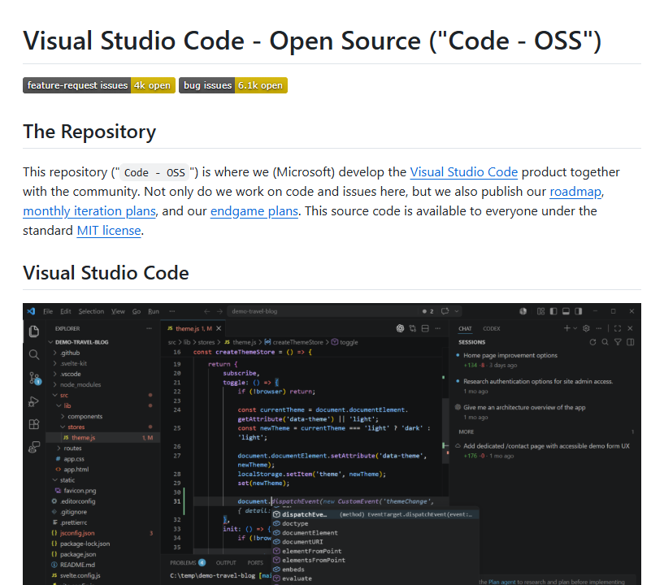 | 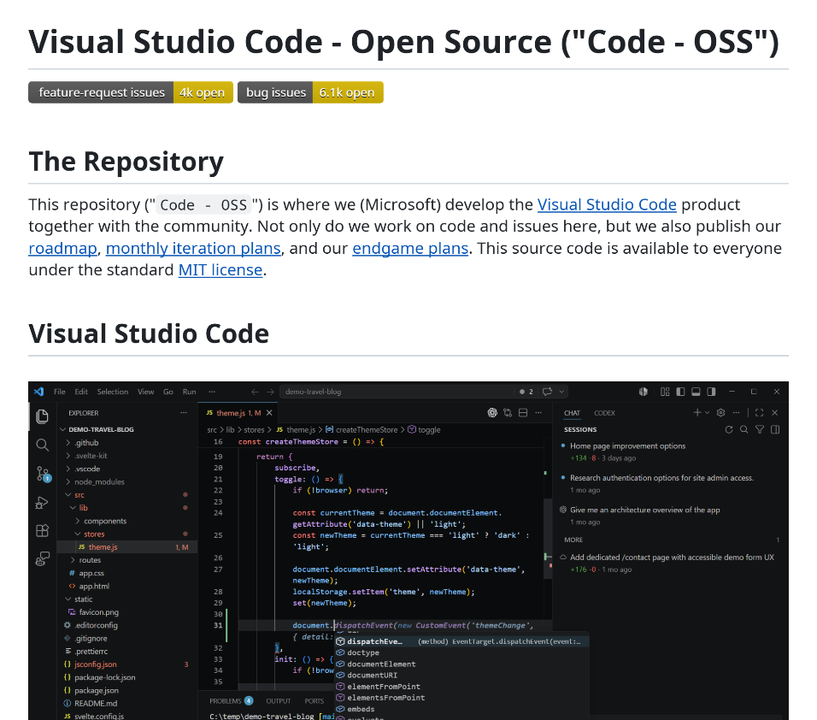 |

### Alerts

[microsoft/markitdown](https://github.com/microsoft/markitdown#readme):
a GitHub `[!IMPORTANT]` alert containing inline code, followed by paragraphs
and a bulleted list.
([PDF](docs/examples/markitdown.pdf))

| Markdown input | PDF output |
| --- | --- |
| 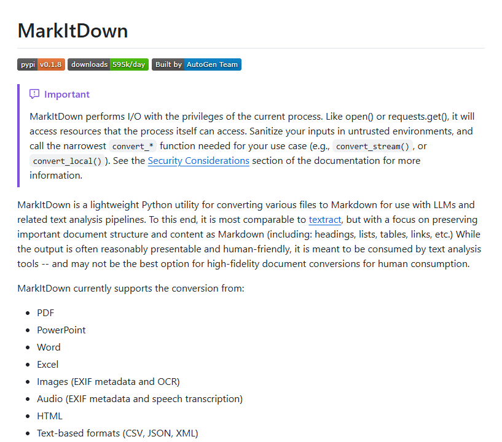 | 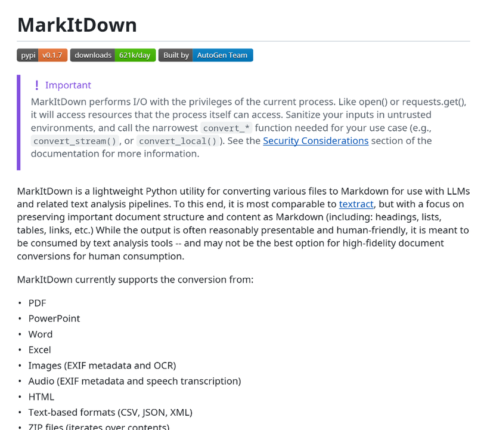 |

### Inline code and heading levels

[actions/checkout](https://github.com/actions/checkout#readme):
first- and second-level headings, nested lists, and frequent inline code.
([PDF](docs/examples/checkout.pdf))

| Markdown input | PDF output |
| --- | --- |
| 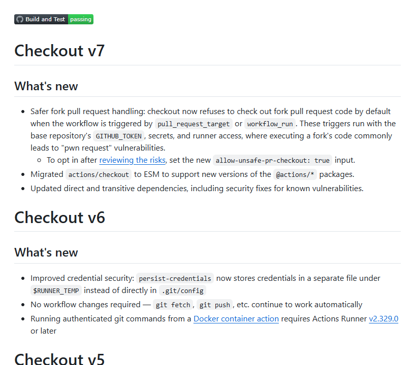 | 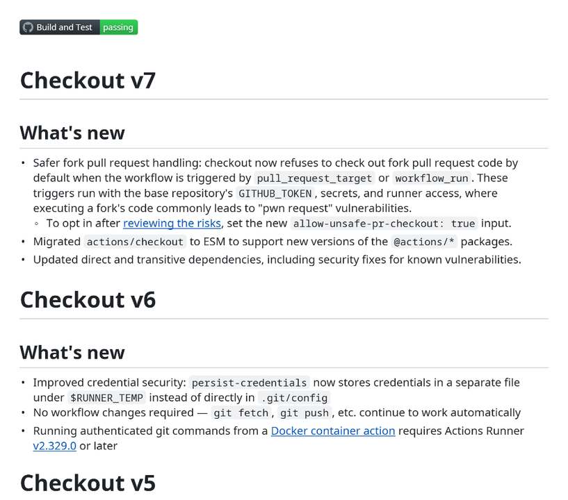 |

### Banner images and badges

[freeCodeCamp/freeCodeCamp](https://github.com/freeCodeCamp/freeCodeCamp#readme):
a full-width banner image, a row of badges, headings, and links.
([PDF](docs/examples/freecodecamp.pdf))

| Markdown input | PDF output |
| --- | --- |
|  | 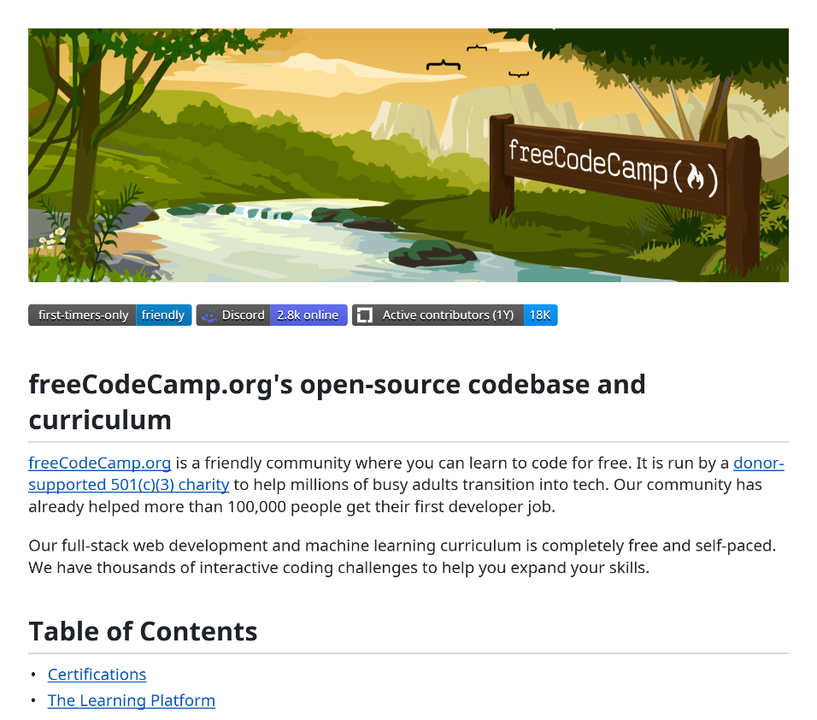 |

### Code blocks with syntax highlighting

[ollama/ollama](https://github.com/ollama/ollama#python) (Python and
JavaScript sections): fenced code blocks with Python and JavaScript syntax
highlighting.
([PDF](docs/examples/ollama.pdf))

| Markdown input | PDF output |
| --- | --- |
| 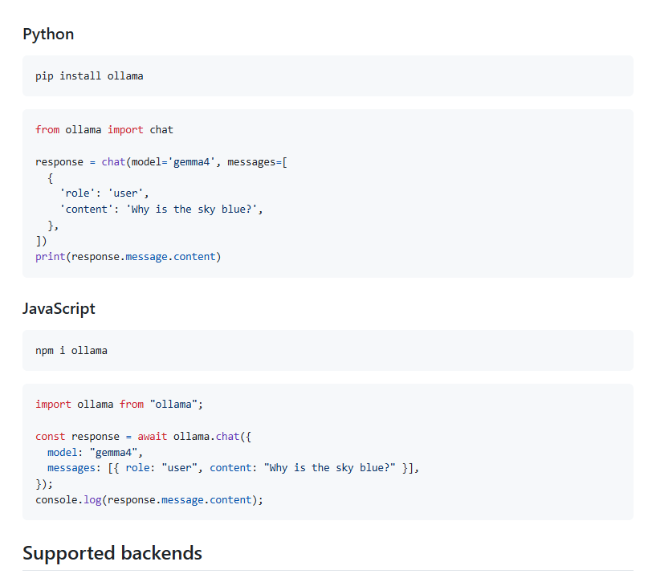 | 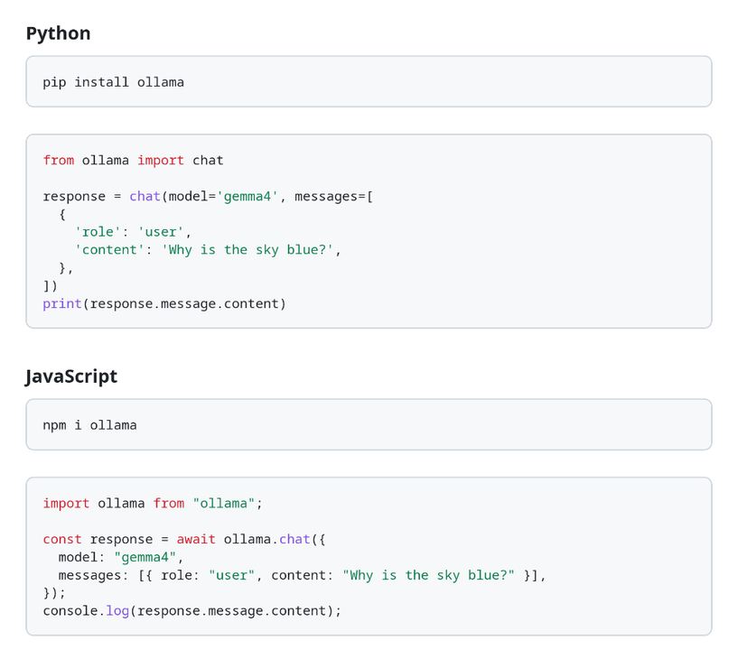 |

### Text formatting

[ohmyzsh/ohmyzsh](https://github.com/ohmyzsh/ohmyzsh#readme):
a centered logo, bold and italic text, inline links, and emoji.
([PDF](docs/examples/ohmyzsh.pdf))

| Markdown input | PDF output |
| --- | --- |
| 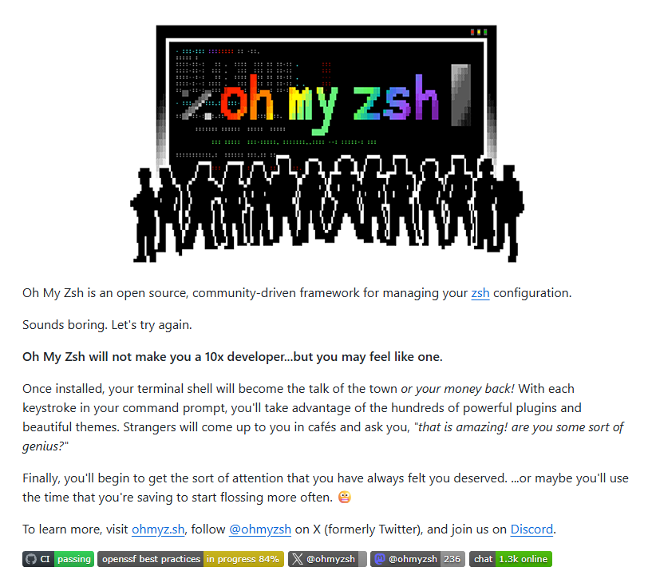 | 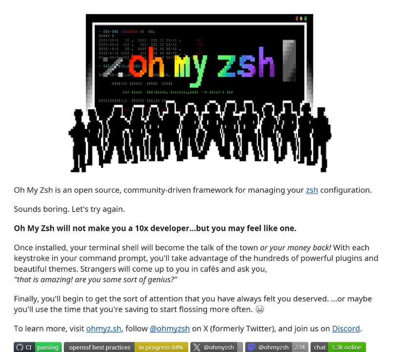 |

Example content is taken from the linked repositories and remains under their
licenses.

## Permissions

The default `GITHUB_TOKEN` is used for the visibility check. If your workflow
restricts permissions, keep at least:

```yaml
permissions:
  contents: read
```

## Troubleshooting

| Message                                                              | Fix                                                                  |
|----------------------------------------------------------------------|----------------------------------------------------------------------|
| `is not public, so it does not qualify as an open source repository` | The action cannot be used on private repositories.                   |
| `No GitHub Actions token available`                                  | Grant `contents: read` permissions to the job.                       |
| `Input path '…' does not exist`                                      | Add `actions/checkout@v4`; paths are relative to the workspace root. |
| `itext-markdown2pdf requires a Linux runner`                         | Use `runs-on: ubuntu-latest`.                                        |
| `itext-markdown2pdf requires an x86_64 runner`                       | Use `ubuntu-latest`, not an ARM runner.                              |
| `Output must be a .zip file` / `Output must be a .pdf file`          | Match the destination extension to folder/file input.                |
| `No PDFs were generated`                                             | Ensure the input folder contains files with the `.md` extension.     |
| `Unknown argument: --repository-name`                                | The bundled binary is outdated; rebuild it before releasing.         |

## Layout

```
action.yml                  # Composite action (entry point)
bin/itext-markdown2pdf      # Bundled Linux x86_64 converter
bin/LICENSE.txt             # Proprietary binary license (not MIT)
bin/THIRD-PARTY-NOTICES.txt  # Full upstream dependency license texts
LICENSE.txt                 # MIT license for original action/wrapper sources
NOTICE.txt                  # License boundaries and dependency inventory
app/                        # Java/GraalVM sources of that converter
scripts/run-convert.sh      # Runs conversion, packages ZIPs, sets action outputs
tests/test_action.py        # Offline wrapper and optional native integration tests
examples/basic-workflow.yml # Example consumer workflow
docs/RELEASING.md           # Release/publish steps
docs/examples/              # Example screenshots and PDFs shown in this README
```

## Contributing

```bash
python3 -m unittest discover -s tests -v
```

These tests use a stub for packaging/error handling and check that the bundled
production binary accepts the action's arguments without bypassing its runner
guard. To also verify real PDF contents locally, build the **testing-only**
executable as described in [`app/README.md`](app/README.md), install
`poppler-utils` (`pdfinfo` and `pdftotext`), then run:

```bash
TEST_CONVERTER_BIN="$PWD/app/target/itext-markdown2pdf-TESTING-ONLY-DO-NOT-SHIP" \
  python3 -m unittest discover -s tests -v
```

Never ship that testing executable. The self-test workflow exercises the
production binary, real GitHub visibility/token checks, action outputs, ZIP
contents, and readable PDF text on a public GitHub repository. The single-file
test uploads one PDF as `self-test-output`; the separate folder test converts
`test-fixtures/multi-markdown` and uploads its ZIP as `self-test-folder-output`.
A successful local run does not replace these hosted checks. Marketplace publishing steps are
in [`docs/RELEASING.md`](docs/RELEASING.md).

## License

The GitHub Action's original source code (including the Java CLI wrapper,
scripts, tests, examples and documentation) is licensed under [MIT](LICENSE.txt).

The bundled **closed-source executable is not MIT-licensed**. It is provided
under the [iText Markdown-to-PDF Binary Limited Use License](bin/LICENSE.txt),
kept beside `bin/itext-markdown2pdf`. Its use is limited to the Official iText
GitHub Action, subject to that agreement. The wrapper's MIT license does not
grant rights to use or redistribute the binary outside those terms.

See [NOTICE](NOTICE) for the dependency inventory and license boundaries, and
[THIRD-PARTY-NOTICES.txt](bin/THIRD-PARTY-NOTICES.txt) for upstream license texts,
including embedded code and fonts. Dependencies retain their own licenses.
Binary releases, including Artifactory distributions, must include the same
license and notices; see [Releasing](docs/RELEASING.md).
